<picture>
  <source media="(prefers-color-scheme: dark)" srcset="readme/hero-dark.svg">
  
</picture>

<picture>
  <source media="(prefers-color-scheme: dark)" srcset="https://skillicons.dev/icons?i=python,sklearn,jupyter,django,react,ts,vite,threejs,electron,flask,postgres,docker,git,github&theme=dark">
  
</picture>

포스코 K-뉴딜 아카데미 3조 **오운완**의 설비 고장 예측 프로젝트임. 연속 소둔로(CAL01) 한 대의 2024년 센서 기록에서 이상 후보를 찾음. 팀이 같은 그래프를 보며 판단한 정답으로 모델을 시험한 뒤, 그 결과를 관제 화면까지 이어 붙임. 데이터는 교육용 재현 데이터이며 실제 조업 데이터가 아님.

## 저장소 세 개, 한 바퀴

<picture>
  <source media="(prefers-color-scheme: dark)" srcset="readme/repos-dark.svg">
  
</picture>

| 저장소 | 하는 일 | 바로 가기 |
| --- | --- | --- |
| [pdm-project](https://github.com/posco-3bungi-pdm/pdm-project) | 정답 만들기(v1 → v7), 모델 비교, 관제용 모델 저장. 데이터·정답·결과 설명은 여기에 다 있음 | [README](https://github.com/posco-3bungi-pdm/pdm-project#readme) · [작업 목록](https://github.com/posco-3bungi-pdm/pdm-project/issues) · [프로젝트 보드](https://github.com/orgs/posco-3bungi-pdm/projects/1) |
| [cal01-review](https://github.com/posco-3bungi-pdm/cal01-review) | 3σ 후보와 모델 후보를 LOT 그래프 위에 띄우고 팀이 1, 0, 보류를 남김 | [사이트](https://cal01-review.onrender.com/) · [README](https://github.com/posco-3bungi-pdm/cal01-review#readme) |
| [cal01-monitor](https://github.com/posco-3bungi-pdm/cal01-monitor) | 3D 소둔로, Z-score 경보, 현장 확인 요청, 구역별 모델 레지스트리 | [사이트](https://cal01-monitor.onrender.com/) · [README](https://github.com/posco-3bungi-pdm/cal01-monitor#readme) |

## 바로 보기

<table>
<tr>
<th width="50%">관제 · CAL01 Monitor</th>
<th width="50%">공동 검토 · cal01-review</th>
</tr>
<tr>
<td></td>
<td></td>
</tr>
</table>

두 사이트 모두 팀 계정으로 들어감. 무료 서버라 15분 동안 쓰지 않으면 잠들고 다시 열 때 1분쯤 걸림.

## 지금까지

| 무엇 | 얼마나 |
| --- | --- |
| 데이터 | LOT 14개, 센서 21개, 원기록 345,390행 → 1분 5,938행 |
| 정답 | v1 → v7. 3σ 통계 후보를 팀 판단 33건, 전 구역 검토 81건, 모델 후보 60건, 규칙 2개로 다듬음 |
| 모델 | Dummy, Z-score, IsolationForest, RandomForest × 구역 9개, 시험 LOT 10개 |
| 결과 | 팀 판단이 있는 Z4에서 Z-score 0.60, RandomForest 0.59. 자세한 표는 [pdm-project 결과](https://github.com/posco-3bungi-pdm/pdm-project#결과) |

## 일하는 방식

**Issue → 작업 브랜치 → PR → CI → 동료 3명 승인 → Squash merge**

- 목적과 완료 기준을 Issue에 남김
- 원본 데이터, CSV, 모델 파일, 비밀값은 올리지 않음
- 시간 순서로 나누고 통계와 전처리는 지나간 값에만 적용함
- 단순 기준선(Z-score)과 모델을 같은 조건에서 비교함
- 팀이 확정한 정답이 없는 구역에서는 F1을 주장하지 않음

자세한 규칙은 [참여 안내](https://github.com/posco-3bungi-pdm/.github/blob/main/CONTRIBUTING.md)와 [pdm-project CONTRIBUTING](https://github.com/posco-3bungi-pdm/pdm-project/blob/main/CONTRIBUTING.md)에 있음.

## 팀

3조 오운완: 김태구(팀장), 김정렬, 박민호, 정수진, 황유진

교육 프로젝트를 위한 팀 조직임. 특정 기업의 공식 서비스나 운영 시스템이 아님.
